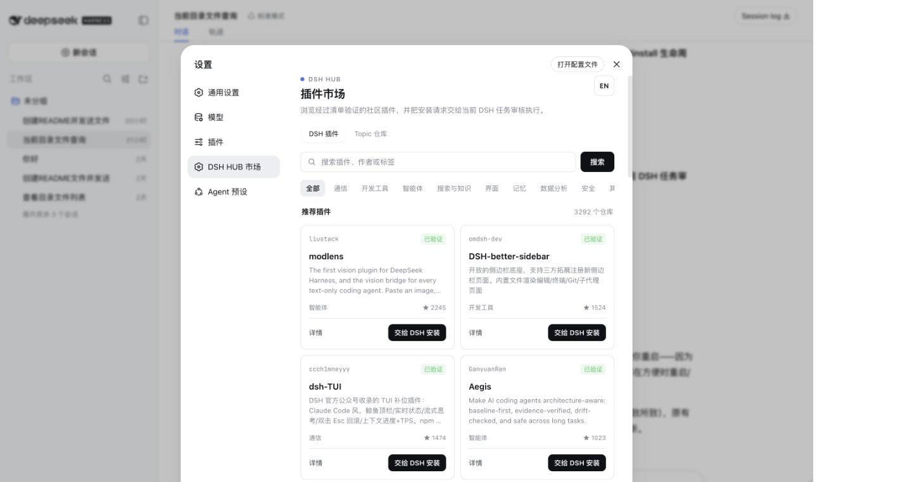

<p align="center">
  
</p>

<h1 align="center">DSH Hub</h1>

<p align="center">
  把社区插件商店装进 DeepSeek Harness。
</p>

<p align="center">
  <a href="https://dsh-hub.cc">插件商店</a>
  ·
  <a href="https://dsh-hub.cc/install/dsh-hub.md">安装说明</a>
  ·
  <a href="#english">English</a>
</p>

<p align="center">
  <a href="https://dsh-hub.cc/install/dsh-hub.md"></a>
  <a href="https://github.com/topics/dsh-plugin"></a>
  <a href="https://dsh-hub.cc"></a>
</p>

<p align="center">
  
</p>

## 它是什么

DSH Hub 是 [dsh-hub.cc](https://dsh-hub.cc) 的原生 DSH 插件。安装后，设置左侧会出现与“插件”并列的 **DSH HUB 市场**，无需离开 DSH 即可搜索、筛选并发起插件安装。

- **原生界面**：复用 DSH 的颜色、间距和交互语言，支持深浅色主题与移动端布局。
- **清单验证**：默认优先展示根目录 `package.json` 声明了 `dsh.bundle.patch` 的仓库。
- **完整目录**：可切换查看 `dsh-plugin` Topic 下的全部仓库，并明确标记可安装状态。
- **先审核再安装**：安装按钮只把请求交给当前 DSH 任务；仓库、Commit、清单、脚本、校验值和权限仍需审核。
- **中英文界面**：插件内可直接切换中文和 English。

## 安装

在 DSH 中新建或打开一个任务，把下面这段话完整交给它：

```text
请严格按照 https://dsh-hub.cc/install/dsh-hub.md 安装 DSH Hub 插件商店。先完成安装包校验和 profile 的 pnpm store 兼容检查，再根据结果只执行普通安装命令，或 install --force 后再 add 的两步修复序列；不要先试错，也不要对 add 使用 --force。不要修改 DeepSeek Harness 源码，也不要在 profile 中直接运行 pnpm install/add。先确认 web profile 目录，若它不在沙箱可写范围，在预检前一次性申请仅覆盖 dsh plugin --profile web 及该 profile 的主机权限。
```

安装并重启 Web profile 后，打开：

```text
设置 → DSH HUB 市场
```

安装包版本、SHA-256 和兼容处理步骤始终以[在线安装说明](https://dsh-hub.cc/install/dsh-hub.md)为准。

## 安装请求如何流转

```text
选择插件
  → DSH Hub 获取该仓库的安装计划
  → 当前 DSH 任务核对仓库、精确 Commit 和 bundle 清单
  → 检查生命周期脚本、profile 权限与 pnpm store
  → 用户确认后由 DSH 执行安装
  → 最小启动验证并回报结果
```

DSH Hub 不绕过 DSH 的权限系统，也不会在点击按钮时直接运行第三方代码。客户端只读取公开目录 API，并把安装请求排入当前任务。

## 目录来源

| 视图 | 收录范围 | 展示优先级 |
| --- | --- | --- |
| DSH 插件 | 已通过 `dsh.bundle.patch` 清单验证的公开仓库 | 默认、高优先级 |
| Topic 仓库 | GitHub `dsh-plugin` Topic 下的全部仓库 | 次级视图，保留状态标记 |

没有添加 Topic 的插件也可以从 DSH Hub 的[发布页面](https://dsh-hub.cc/publish)直接提交公开 GitHub 仓库。

## 本地开发

需要 Node.js 22.19+ 与 pnpm 10：

```bash
pnpm install
pnpm lint
pnpm test
pnpm build
```

| 路径 | 用途 |
| --- | --- |
| `src/client.tsx` | DSH 设置页、目录查询与安装请求交互 |
| `src/index.ts` | Host 侧插件入口 |
| `cordis.patch.yml` | 安装到 profile 的 DSH bundle patch |
| `lib/` | 可直接从 Git 仓库安装的已构建产物 |
| `tests/` | 注册入口与安装 Prompt 测试 |

问题和建议可以直接提交到 [Issues](https://github.com/sliverp/dsh-hub-plugin/issues)。

---

<h2 id="english">English</h2>

DSH Hub brings the community plugin marketplace at [dsh-hub.cc](https://dsh-hub.cc) into DeepSeek Harness as a native Settings section.

- Browse manifest-verified DSH plugins first, with every `dsh-plugin` Topic repository available in a secondary view.
- Search, filter, inspect status, and hand installation requests to the active DSH task without leaving DSH.
- Keep repository, exact commit, lifecycle-script, permission, checksum, and pnpm-store review in the normal DSH workflow.
- Use the interface in Chinese or English.

Paste this into an active DSH task to install:

```text
Install DSH Hub by following https://dsh-hub.cc/install/dsh-hub.md?lang=en exactly. Verify the package and run the profile pnpm-store compatibility check, then run only the normal install command or the two-step install --force followed by add recovery sequence. Do not trial-and-error and do not pass --force to add. Do not modify DeepSeek Harness source or run pnpm install/add directly in the profile. Resolve the web profile first; if it is outside the writable sandbox, request one host permission scoped to dsh plugin --profile web and that profile before the preflight.
```

After restarting the Web profile, open **Settings → DSH HUB Market**. See the [live installation guide](https://dsh-hub.cc/install/dsh-hub.md?lang=en) for the current package version and checksum.
